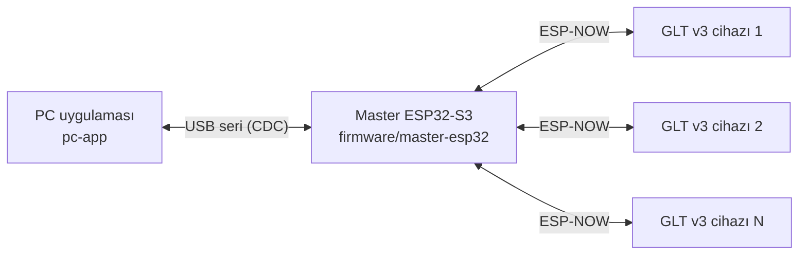

# GloveTestSystem — Ultra GITS / GLT v3

Eldiven sızdırmazlık (kaçak) testi yapan **GLT v3** cihazlarını PC üzerinden yöneten test sistemi.
PC yazılımı; kullanıcı yetkilendirme, audit trail ve elektronik imza gibi 21 CFR Part 11 gereksinimleri
hedeflenerek geliştirilmiştir.

Depo, birlikte çalışan üç projeden oluşur:

| Klasör | Proje | Görev |
|---|---|---|
| [`pc-app/`](pc-app/) | **Ultra GITS** PC uygulaması (Python 3, PyQt5) | Arayüz, kullanıcı/yetki yönetimi, test, reçete ve batch yönetimi, SQLite veritabanı, PDF raporlar |
| [`firmware/master-esp32/`](firmware/master-esp32/) | **Master** ESP32-S3 firmware'i (PlatformIO) | PC'ye USB ile bağlanır; PC ile test cihazları arasında ESP-NOW köprüsüdür |
| [`firmware/glt-v3/`](firmware/glt-v3/) | **GLT v3** test cihazı firmware'i (PlatformIO) | Basınç, RFID, valf ve pompa donanımını sürer; testi yürütür ve ölçümleri gönderir |

```
GloveTestSystem/
├── pc-app/                  # Ultra GITS PC uygulaması
├── firmware/
│   ├── master-esp32/        # USB ↔ ESP-NOW köprüsü (master)
│   └── glt-v3/              # Test cihazı (slave)
├── tools/                   # Geliştirme/teşhis betikleri
└── docs/                    # Ek teknik notlar
```

## Sistem mimarisi



- **PC uygulaması** GLT v3 cihazlarıyla doğrudan değil, yalnızca master üzerinden haberleşir.
- **Master** test mantığı içermez: PC'den gelen komutları ESP-NOW ile cihazlara iletir, cihazlardan gelen
  her mesajı gönderenin MAC adresiyle birlikte PC'ye aktarır. En fazla 20 cihaz kaydedebilir.
- **GLT v3** cihazları (kodda *slave*) testi yürütür, ölçümleri yaklaşık 200 ms aralıkla master üzerinden
  PC'ye gönderir ve kayıtlarını SD karta yazar.

### PC ↔ Master (USB seri)

- Master, ESP32-S3'ün yerel USB portunu (USB CDC) kullanır. PC uygulaması otomatik taramada önce Espressif
  USB kimliğine (`VID:PID 303A:1001`) sahip portu dener.
- Haberleşme satır tabanlıdır; her satır `\n` ile biter.
- `{` ile başlayan satırlar (JSON) bağlı **tüm** cihazlara iletilir. Diğer satırlar master komutlarıdır:

| Komut | İşlev |
|---|---|
| `help`, `list` | Yardım / kayıtlı cihaz listesi |
| `addslave <ad> <MAC>` | Cihazı elle kaydeder |
| `send <ad\|MAC> <mesaj>` | Tek bir cihaza mesaj (genellikle JSON) gönderir |
| `setparam <ad> <anahtar> <değer>` | Cihaza `SET_PARAM` gönderir |
| `getparam <ad> <anahtar>` | Cihaza `GET_PARAM` gönderir |
| `setname <ad> <yeni_ad>` | Cihaza `SET_NAME` gönderir |

- Cihazlardan gelen mesajlar PC'ye `[AA:BB:CC:DD:EE:FF] <mesaj>` biçiminde iletilir.

### Master ↔ GLT v3 (ESP-NOW)

- Wi-Fi kanalı 1, şifrelemesiz ESP-NOW kullanılır.
- Master sabit `AA:BB:CC:DD:EE:FF` MAC adresini kullanır; GLT v3 cihazları bu adresi eş (peer) olarak ekler
  ([`ESPNowSlave.h`](firmware/glt-v3/src/services/ESPNowSlave.h)). Ayrı bir eşleştirme adımı gerekmez.
- Master, ilk kez mesaj aldığı cihazı `Slave_XXXX` adıyla otomatik kaydeder.

### Tipik test akışı

1. PC uygulaması master'a bağlanır, `list` ile cihazları alır ve `SET_TIME` ile cihaz saatini (DS3231 RTC) eşitler.
2. Kayıtlı RFID etiketleri cihazlara aktarılır (`RFID_SYNC_START` ile parça parça gönderim).
3. `MOUNT` ve `START_TEST` komutlarıyla test başlatılır; cihaz `ACK_*` ve `TEST_STARTED` mesajlarıyla yanıt verir.
   `ABORT` testi iptal eder.
4. Ölçümler canlı olarak PC'ye akar; PC grafikleri çizer, sonuçları SQLite veritabanına yazar ve PDF rapor üretir.
5. `DISMOUNT` ile döngü tamamlanır; cihazdaki test geçmişi `GET_TEST_HISTORY` ile alınabilir.

Cihazın işlediği tüm komutlar: [`ESPNowSlave.cpp`](firmware/glt-v3/src/services/ESPNowSlave.cpp).

### PC uygulamasının diğer entegrasyonları

ORAPS sekmesi, sistemi aşağıdaki harici donanımlarla birlikte kullanır:

- **Weidmüller uzak I/O modülleri:** Modbus TCP üzerinden dijital/analog giriş-çıkışlar (kapı, interlock, alarm)
- **LAF (Laminar Air Flow) sensörleri:** Modbus RTU (seri port)
- **Kablosuz IR bariyer sensörleri:** Ayrı bir master üzerinden seri port. Bu sensörlerin firmware'i bu depoda yer almaz.
- **3D görünüm:** QtWebEngine + Three.js ([`pc-app/src/assets/viewer/`](pc-app/src/assets/viewer/)).
  GLB/GLTF modeli depoda yoktur; Ayarlar > ORAPS ekranından dosya olarak seçilir.

## Donanım özeti

**Master:** ESP32-S3-DevKitM-1, yerel USB. Durum LED'leri GPIO41 (aktivite) ve GPIO45 (bağlı cihaz var).

**GLT v3:** ESP32-S3-DevKitM-1 (4 MB flash, PSRAM)

- Basınç sensörü (Modbus RTU), conta basıncı için 4–20 mA analog giriş
- RDM6300 125 kHz RFID okuyucu
- DS3231 RTC, ADS1115 ADC (I²C), SD kart (SD_MMC)
- 4 röle: conta solenoidi, pompa motoru, eldiven solenoidi, tahliye solenoidi
- Buzzer, durum/hata LED'leri, 5S batarya izleme, DWIN seri ekran
- Wi-Fi üzerinden ArduinoOTA güncelleme desteği

Pin atamaları: [`firmware/glt-v3/include/config.h`](firmware/glt-v3/include/config.h)

## Kurulum

### PC uygulaması

Gereksinimler: Windows 10/11, Python 3.8+

```powershell
cd pc-app
pip install -r requirements.txt
python src/main.py        # veya BASLAT.bat / start.ps1
```

İlk giriş bilgileri ve kullanım ayrıntıları için [`pc-app/README.md`](pc-app/README.md) dosyasına,
son kullanıcı kılavuzu için [`Ultra GITS Kullanım Kılavuzu.md`](<pc-app/Ultra GITS Kullanım Kılavuzu.md>) dosyasına bakın.

Depoda veritabanı bulunmaz. Uygulama ilk açılışta yalnızca varsayılan `admin` hesabını içeren boş bir
veritabanı oluşturur.

Geliştirme modunda veritabanı, PDF raporlar ve batch verileri çalışma dizinine göre `database/`, `reports/`
ve `batches/` klasörlerine yazılır. `start.ps1` uygulamayı `src/` içinden başlattığı için bu durumda klasörler
`src/` altında oluşur. Uygulama logu `pc-app/app.log` dosyasına yazılır. Kurulu sürüm bu verileri
`%LOCALAPPDATA%\Ultra GITS` altında tutar. Bu dosyaların hiçbiri Git'e gönderilmez.

### Firmware'ler

[PlatformIO](https://platformio.org/) gerekir (VS Code eklentisi veya `pip install platformio`). Komutlar depo kökünden çalıştırılır:

```powershell
# Master
pio run -d firmware/master-esp32
pio run -d firmware/master-esp32 -t upload --upload-port COMx

# GLT v3 (ilk kurulumda secrets.h oluşturup Wi-Fi bilgilerini girin)
Copy-Item firmware/glt-v3/include/secrets.example.h firmware/glt-v3/include/secrets.h
pio run -d firmware/glt-v3
pio run -d firmware/glt-v3 -t upload --upload-port COMx
```

- `platformio.ini` dosyalarındaki `upload_port` / `monitor_port` değerleri geliştirme bilgisayarına göre
  ayarlanmıştır (GLT v3: `COM19`, master: `COM6`). Kendi portunuza göre değiştirin veya `--upload-port` kullanın.
- GLT v3'ün Wi-Fi/OTA bilgileri `firmware/glt-v3/include/secrets.h` dosyasındadır ve Git'e gönderilmez.
  Dosya yoksa derleme `secrets.example.h` ile uyarı vererek devam eder; bu durumda OTA için Wi-Fi'ye bağlanılamaz.
- [`firmware/glt-v3/safe_upload.bat`](firmware/glt-v3/safe_upload.bat), yükleme sırasında `pc-app/upload_mode.flag`
  dosyasını oluşturur; böylece `pc-app/monitor_dashboard.py` seri portu geçici olarak bırakır.
- Master için hazır yükleme betikleri de vardır: `flash_com4.bat`, `flash_com6.bat`. İçlerindeki port numaralarını kontrol edin.

### Windows kurulum paketi

```powershell
cd pc-app
powershell -ExecutionPolicy Bypass -File build_exe.ps1
```

- PyInstaller ([`GloveTestSystem.spec`](pc-app/GloveTestSystem.spec)) ile `dist/GloveTestSystem/` oluşturulur
  ve ZIP paketi hazırlanır. Inno Setup 5/6 kuruluysa [`installer.iss`](pc-app/installer.iss) ile
  `installer_output/` altında kurulum dosyası da üretilir.
- Kurulum paketi Microsoft Visual C++ yeniden dağıtılabilir paketini içerir. `vc_redist.x64.exe` dosyasını
  [Microsoft'tan](https://aka.ms/vs/17/release/vc_redist.x64.exe) indirip `pc-app/redist/` klasörüne koyun.
- Derlenmiş kurulum dosyalarını depoya eklemek yerine **GitHub Releases** üzerinden paylaşın.

## Depoya dahil edilmeyenler

[`.gitignore`](.gitignore) aşağıdakileri hariç tutar. Bunlar yerelde oluşur veya ayrıca paylaşılır:

- Veritabanları (`*.db`), loglar, PDF raporlar, batch verileri ve arayüzden yüklenen görseller
- Müşteriye özel 3D modeller (`*.glb`, `*.gltf`) ve Office dokümanları (`*.docx`, `*.xlsx`). Alarm kodu ve
  interlock matrisi Excel dosyaları `pc-app/_gen_alarm_codes_xlsx.py` ve `pc-app/_gen_interlock_matrix_xlsx.py`
  ile yeniden üretilebilir.
- PyInstaller ve Inno Setup çıktıları (`build/`, `dist/`, `installer_output/`, ZIP) ile `redist/`
- PlatformIO çıktıları (`.pio/`), `*.bin`, `*.elf`, `*.exe`, `*.zip`, `*.rar`
- `firmware/glt-v3/include/secrets.h`

## Diğer klasörler

- [`tools/`](tools/): Geliştirme sırasında kullanılan teşhis betikleri (seri port izleme, veritabanı
  karşılaştırma/migrasyon, uçtan uca test, NotebookLM dışa aktarımı). Çoğunda COM port numaraları ve
  veritabanı yolları sabit yazılıdır; çalıştırmadan önce düzenleyin.
- [`docs/`](docs/): Ek teknik notlar.
- Otomatik test paketi yoktur. `pc-app/test_*.py` ve `pc-app/_verify_*.py` dosyaları tek tek çalıştırılan
  doğrulama/teşhis betikleridir; bazıları bağlı donanım gerektirir.
