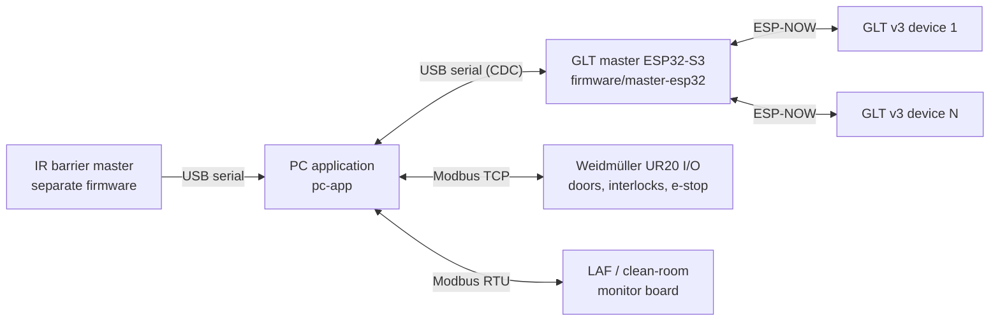

# oRABS — Ultra GITS

Monitoring and control system for an **oRABS** (open Restricted Access Barrier System) line that also manages
wireless **GLT v3** glove leak (integrity) testers. The PC application has two main parts:

- **oRABS monitoring & control (ORAPS module):** 3D overview, door interlocks and batch management, emergency stop,
  Weidmüller remote I/O, LAF / clean-room sensors, wireless IR barrier sensors and alarms
- **GLT glove testing:** ESP32-S3 based wireless test devices, managed through a USB ↔ ESP-NOW master bridge

The PC software is designed with 21 CFR Part 11 requirements in mind, such as user/role management,
audit trail and electronic signatures.

The repository contains three projects that work together:

| Folder | Project | Role |
|---|---|---|
| [`pc-app/`](pc-app/) | **Ultra GITS** PC application (Python 3, PyQt5) | oRABS monitoring/control and GLT test management; users/permissions, recipes and batches, SQLite database, PDF reports |
| [`firmware/master-esp32/`](firmware/master-esp32/) | **Master** ESP32-S3 firmware (PlatformIO) | Connects to the PC over USB; ESP-NOW bridge between the PC and the test devices |
| [`firmware/glt-v3/`](firmware/glt-v3/) | **GLT v3** test device firmware (PlatformIO) | Drives the pressure, RFID, valve and pump hardware; runs the test and sends measurements |

```
oRABS/
├── pc-app/                  # Ultra GITS PC application (oRABS + GLT)
├── firmware/
│   ├── master-esp32/        # USB ↔ ESP-NOW bridge (master)
│   └── glt-v3/              # Test device (slave)
├── tools/                   # Development/diagnostic scripts
└── docs/                    # Additional technical notes
```

## System architecture



- **oRABS hardware** (Weidmüller I/O, LAF board, IR barriers) connects directly to the PC application, independently of the GLT master.
- The **PC application** never talks to GLT v3 devices directly, only through the master.
- The **master** contains no test logic: it forwards commands from the PC to the devices over ESP-NOW and relays
  every device message to the PC together with the sender's MAC address. It can register up to 20 devices.
- **GLT v3** devices (*slaves* in the code) run the test, send measurements to the PC through the master
  roughly every 200 ms and log records to an SD card.

## oRABS monitoring & control (ORAPS module)

The ORAPS section of the PC application monitors and controls the oRABS line:

- **Overview:** 3D model of the oRABS (front/back/left/right views), door states for the active batch,
  LAF readings and cards for the connected GLT devices
- **Batch:** Door-lock (interlock) configurations; starting and tracking batches
- **IO (admin only):** Weidmüller UR20-FBC-MOD-TCP remote I/O modules; live DI/DO/AI/AO monitoring and
  output control over Modbus TCP
- **Emergency stop & machine stop:** Pressing the emergency stop automatically pauses the active batch; machine
  stop groups drive Weidmüller outputs
- **LAF (Laminar Air Flow):** Live readings from the clean-room monitor board over Modbus RTU (serial), alarm log and PDF report
- **Wireless IR barrier sensors:** Port motion events are received over a serial port through a separate master.
  The firmware for these sensors is not part of this repository.
- **3D view:** QtWebEngine + Three.js ([`pc-app/src/assets/viewer/`](pc-app/src/assets/viewer/)).
  No GLB/GLTF model is included in the repository; select the model file under Settings > ORAPS.

Configuration changes and I/O writes are recorded in the audit trail.

## GLT glove testing

### PC ↔ Master (USB serial)

- The master uses the ESP32-S3's native USB port (USB CDC). During auto-detection, the PC application first tries
  ports with the Espressif USB ID (`VID:PID 303A:1001`).
- The protocol is line-based; every line ends with `\n`.
- Lines starting with `{` (JSON) are forwarded to **all** connected devices. All other lines are master commands:

| Command | Function |
|---|---|
| `help`, `list` | Help / list of registered devices |
| `addslave <name> <MAC>` | Registers a device manually |
| `send <name\|MAC> <message>` | Sends a message (usually JSON) to a single device |
| `setparam <name> <key> <value>` | Sends `SET_PARAM` to the device |
| `getparam <name> <key>` | Sends `GET_PARAM` to the device |
| `setname <name> <new_name>` | Sends `SET_NAME` to the device |

- Messages from devices are forwarded to the PC as `[AA:BB:CC:DD:EE:FF] <message>`.

### Master ↔ GLT v3 (ESP-NOW)

- Unencrypted ESP-NOW on Wi-Fi channel 1.
- The master uses the fixed MAC address `AA:BB:CC:DD:EE:FF`; GLT v3 devices add this address as a peer
  ([`ESPNowSlave.h`](firmware/glt-v3/src/services/ESPNowSlave.h)), so no separate pairing step is needed.
- The master automatically registers a device as `Slave_XXXX` when it receives its first message.

### Typical test flow

1. The PC application connects to the master, gets the device list with `list` and synchronizes the device clock
   (DS3231 RTC) with `SET_TIME`.
2. Registered RFID tags are transferred to the devices (sent in chunks with `RFID_SYNC_START`).
3. The test is started with the `MOUNT` and `START_TEST` commands; the device responds with `ACK_*` and
   `TEST_STARTED` messages. `ABORT` cancels the test.
4. Measurements stream live to the PC; the PC plots them, stores the results in the SQLite database and
   generates a PDF report.
5. `DISMOUNT` completes the cycle; the device's test history can be retrieved with `GET_TEST_HISTORY`.

All commands handled by the device: [`ESPNowSlave.cpp`](firmware/glt-v3/src/services/ESPNowSlave.cpp).

## Hardware overview

**oRABS:** Weidmüller UR20-FBC-MOD-TCP remote I/O (Modbus TCP), LAF / clean-room monitor board (Modbus RTU),
wireless IR barrier sensors and their master (separate firmware).

**GLT master:** ESP32-S3-DevKitM-1, native USB. Status LEDs on GPIO41 (activity) and GPIO45 (device connected).

**GLT v3:** ESP32-S3-DevKitM-1 (4 MB flash, PSRAM)

- Pressure sensor (Modbus RTU), 4–20 mA analog input for seal pressure
- RDM6300 125 kHz RFID reader
- DS3231 RTC, ADS1115 ADC (I²C), SD card (SD_MMC)
- 4 relays: seal solenoid, pump motor, glove solenoid, drain solenoid
- Buzzer, status/error LEDs, 5S battery monitoring, DWIN serial display
- ArduinoOTA updates over Wi-Fi

Pin assignments: [`firmware/glt-v3/include/config.h`](firmware/glt-v3/include/config.h)

## Setup

### PC application

Requirements: Windows 10/11, Python 3.8+

```powershell
cd pc-app
pip install -r requirements.txt
python src/main.py        # or BASLAT.bat / start.ps1
```

See [`pc-app/README.md`](pc-app/README.md) for first-login credentials and usage details, and
[`Ultra GITS Kullanım Kılavuzu.md`](<pc-app/Ultra GITS Kullanım Kılavuzu.md>) for the end-user manual (Turkish).

No database is included in the repository. On first start, the application creates an empty database that
contains only the default `admin` account.

In development mode, the database, PDF reports and batch data are written to the `database/`, `reports/` and
`batches/` folders relative to the working directory. Because `start.ps1` starts the application from `src/`,
these folders are then created under `src/`. The application log is written to `pc-app/app.log`. The installed
version keeps this data under `%LOCALAPPDATA%\Ultra GITS`. None of these files are committed to Git.

### Firmware

Requires [PlatformIO](https://platformio.org/) (VS Code extension or `pip install platformio`).
Run the commands from the repository root:

```powershell
# Master
pio run -d firmware/master-esp32
pio run -d firmware/master-esp32 -t upload --upload-port COMx

# GLT v3 (on first setup, create secrets.h and enter the Wi-Fi credentials)
Copy-Item firmware/glt-v3/include/secrets.example.h firmware/glt-v3/include/secrets.h
pio run -d firmware/glt-v3
pio run -d firmware/glt-v3 -t upload --upload-port COMx
```

- The `upload_port` / `monitor_port` values in the `platformio.ini` files match the development machine
  (GLT v3: `COM19`, master: `COM6`). Change them to your port or use `--upload-port`.
- The GLT v3 Wi-Fi/OTA credentials are stored in `firmware/glt-v3/include/secrets.h`, which is not committed to Git.
  If the file is missing, the build continues with `secrets.example.h` and shows a warning; in that case OTA
  cannot connect to Wi-Fi.
- [`firmware/glt-v3/safe_upload.bat`](firmware/glt-v3/safe_upload.bat) creates `pc-app/upload_mode.flag` during
  upload so that `pc-app/monitor_dashboard.py` temporarily releases the serial port.
- Ready-made upload scripts are also available for the master: `flash_com4.bat` and `flash_com6.bat`.
  Check the port numbers inside them.

### Windows installer

```powershell
cd pc-app
powershell -ExecutionPolicy Bypass -File build_exe.ps1
```

- PyInstaller ([`GloveTestSystem.spec`](pc-app/GloveTestSystem.spec)) builds `dist/GloveTestSystem/`, and a ZIP
  package is created. If Inno Setup 5/6 is installed, [`installer.iss`](pc-app/installer.iss) also produces a
  setup file under `installer_output/`.
- The installer bundles the Microsoft Visual C++ Redistributable. Download `vc_redist.x64.exe`
  [from Microsoft](https://aka.ms/vs/17/release/vc_redist.x64.exe) and place it in `pc-app/redist/`.
- Share built installers through **GitHub Releases** instead of committing them to the repository.

## Not included in the repository

[`.gitignore`](.gitignore) excludes the following. These files are generated locally or shared separately:

- Databases (`*.db`), logs, PDF reports, batch data and images uploaded through the UI
- Customer-specific 3D models (`*.glb`, `*.gltf`) and Office documents (`*.docx`, `*.xlsx`). The alarm code and
  interlock matrix Excel files can be regenerated with `pc-app/_gen_alarm_codes_xlsx.py` and
  `pc-app/_gen_interlock_matrix_xlsx.py`.
- PyInstaller and Inno Setup output (`build/`, `dist/`, `installer_output/`, ZIP) and `redist/`
- PlatformIO output (`.pio/`), `*.bin`, `*.elf`, `*.exe`, `*.zip`, `*.rar`
- `firmware/glt-v3/include/secrets.h`

## Other folders

- [`tools/`](tools/): Diagnostic scripts used during development (serial port monitoring, database
  comparison/migration, end-to-end testing, NotebookLM export). Most of them contain hard-coded COM port numbers
  and database paths; edit them before running.
- [`docs/`](docs/): Additional technical notes (Turkish).
- There is no automated test suite. `pc-app/test_*.py` and `pc-app/_verify_*.py` are standalone
  verification/diagnostic scripts; some of them require connected hardware.
